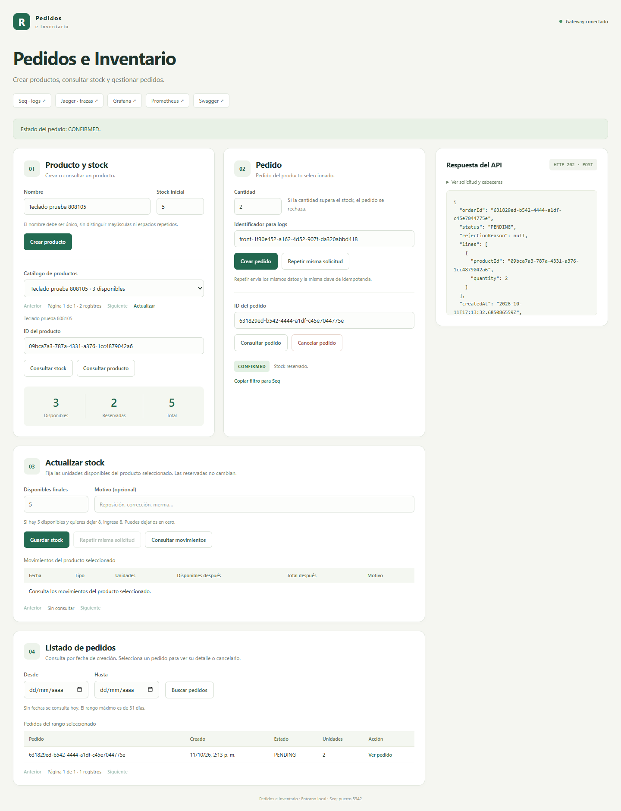
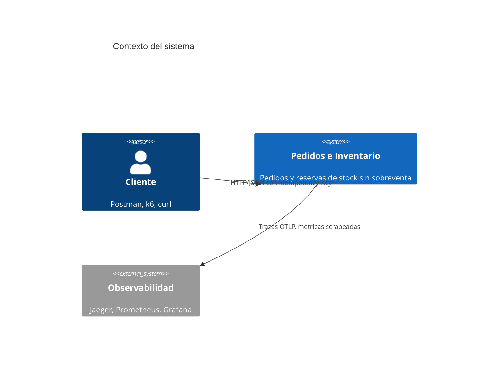
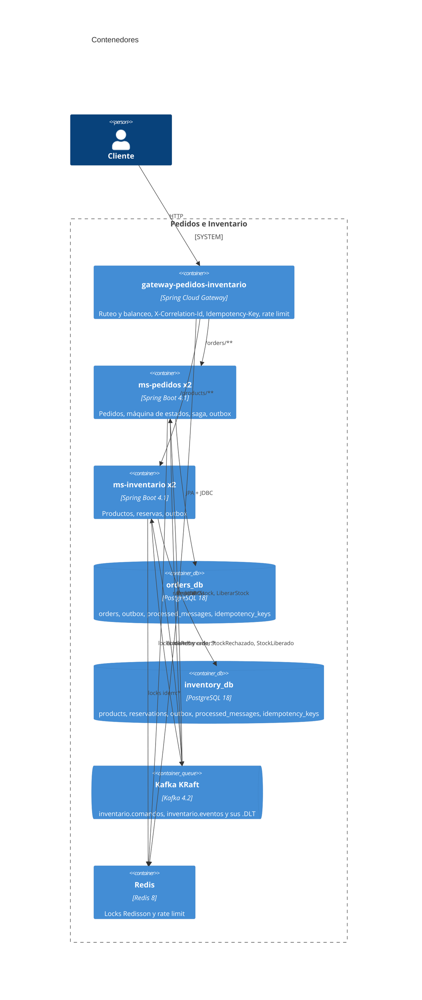
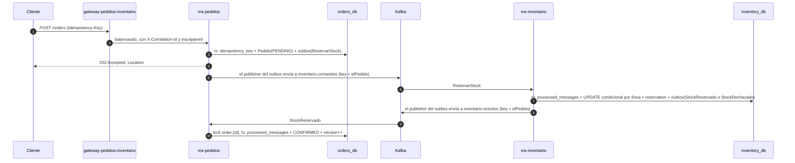
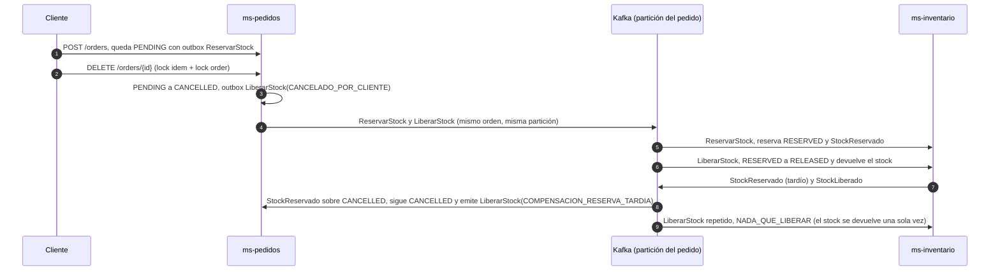
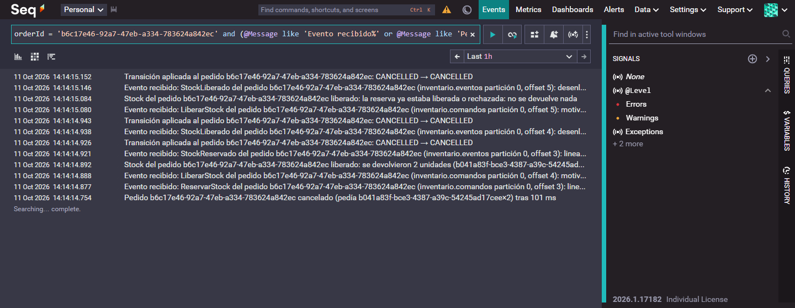
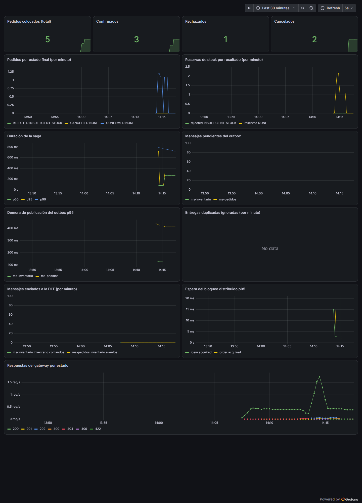
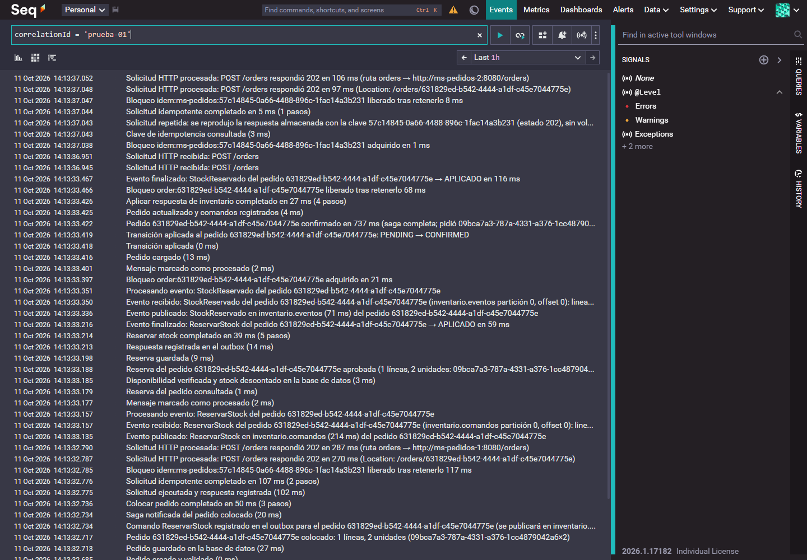

# Pedidos e Inventario

Sistema de pedidos e inventario que reserva stock sin vender más unidades de las que hay. Resuelve la [prueba técnica](docs/enunciado/prueba-tecnica.pdf) (los requisitos están numerados en [docs/enunciado/requisitos.md](docs/enunciado/requisitos.md)) y aguanta:

- solicitudes concurrentes y varias instancias de cada servicio,
- mensajes duplicados (la mensajería es at-least-once),
- errores temporales,
- cancelaciones que llegan mientras la reserva sigue en curso.

Piezas:

- `ms-pedidos`: pedidos y orquestación de la saga.
- `ms-inventario`: productos, stock y reservas.
- `gateway-pedidos-inventario`: punto de entrada, sin lógica de negocio.

Cada servicio tiene su propia base Postgres y se hablan por Kafka. Para que no se pierda ni se duplique nada se usa Transactional Outbox, consumidores idempotentes, idempotencia HTTP y locks distribuidos con Redisson (estos últimos como refuerzo, no como garantía).

Stack: Java 25, Spring Boot 4.1 (el gateway va en 4.0 con Spring Cloud 2025.1, ver [ADR 0008](docs/adr/0008-plataforma-y-versiones.md)), PostgreSQL 18, Kafka 4.2 en modo KRaft, Redis 8, OpenTelemetry, Jaeger, Seq, Prometheus y Grafana.

---

## Cómo levantarlo

Hace falta Docker Desktop (con WSL2 en Windows), JDK 25 y Git. Maven no se instala: el repo trae el wrapper.

```bash
# Linux, macOS o Git Bash
scripts/up.sh      # compilar, construir las imágenes y levantar todo
scripts/down.sh    # bajar todo y borrar los volúmenes
```

```powershell
# PowerShell
scripts\up.ps1
scripts\down.ps1
```

`up` compila los jars (`./mvnw -DskipTests package`), construye las imágenes y espera a que todo esté healthy. El stack levanta dos réplicas de cada servicio más Grafana y consume unos 5 GB, por lo que se recomienda darle 8 GB a Docker Desktop (Settings, Resources, o `.wslconfig`).

| Qué | URL |
|---|---|
| Gateway (entrada de todo) | http://localhost:8080 |
| ms-pedidos, réplicas 1 y 2 | http://localhost:8081 y http://localhost:8082 |
| ms-inventario, réplicas 1 y 2 | http://localhost:8091 y http://localhost:8092 |
| Swagger UI (ambos servicios) | http://localhost:8080/docs |
| Jaeger (trazas) | http://localhost:16686 |
| Seq (logs de los tres servicios) | http://localhost:5342 (sin login; el puerto se cambia con `SEQ_PUERTO`) |
| Grafana (acceso anónimo) | http://localhost:3000, dashboard "Pedidos e Inventario" |
| Prometheus | http://localhost:9090 |

### Front local

Con el stack arriba y Node.js 22 o superior, ejecutar `scripts/front.sh` (Git Bash) o `scripts\front.ps1` (PowerShell) y abrir http://localhost:5173. Sirve para recorrer el catálogo, consultar stock, crear y cancelar pedidos, buscar pedidos por fecha, fijar el stock disponible y ver los movimientos. No instala paquetes y Ctrl+C lo cierra sin tocar Docker. La guía está en [front/README.md](front/README.md).



### Probarlo con curl

```bash
curl -s -X POST localhost:8080/products -H 'Content-Type: application/json' \
  -H "Idempotency-Key: $(uuidgen)" -d '{"name":"Keyboard","initialQuantity":5}'
# 201 {"productId":"...","total":5,"available":5,"reserved":0}

curl -s -i -X POST localhost:8080/orders -H 'Content-Type: application/json' \
  -H "Idempotency-Key: $(uuidgen)" -d '{"lines":[{"productId":"<productId>","quantity":2}]}'
# 202 con Location: /orders/<orderId> (estado PENDING)

curl -s localhost:8080/orders/<orderId>               # CONFIRMED a los pocos milisegundos
curl -s localhost:8080/products/<productId>/stock     # available 3, reserved 2
curl -s -X DELETE localhost:8080/orders/<orderId> -H "Idempotency-Key: $(uuidgen)"
curl -s -X PUT localhost:8080/products/<productId>/stock -H 'Content-Type: application/json' \
  -H "Idempotency-Key: $(uuidgen)" -d '{"available":50,"reason":"Reposición"}'
curl -s "localhost:8080/orders?from=10/01/2026&to=10/10/2026&page=0&size=20"
```

---

## API

Todo pasa por el gateway (`localhost:8080`). La documentación interactiva, con ejemplos de cada error, está en http://localhost:8080/docs.

| Método y ruta | Qué hace | Idempotency-Key |
|---|---|---|
| `POST /products` | Crea un producto con su stock inicial | Sí |
| `GET /products?page=&size=` | Lista productos paginados, ordenados por nombre | No |
| `GET /products/{productId}` | Un producto con su stock | No |
| `GET /products/{productId}/stock` | Stock total, disponible y reservado | No |
| `PUT /products/{productId}/stock` | Fija las unidades disponibles (las reservadas no cambian) y registra un movimiento | Sí |
| `GET /products/{productId}/stock/movements?page=&size=` | Historial de cambios de stock | No |
| `POST /orders` | Crea un pedido (responde `202` y queda `PENDING`) | Sí |
| `GET /orders?from=&to=&page=&size=` | Lista pedidos por rango de fechas `MM/dd/yyyy` (hoy por defecto, máximo 31 días) | No |
| `GET /orders/{orderId}` | Un pedido con su estado y sus líneas | No |
| `DELETE /orders/{orderId}` | Cancela el pedido y libera su stock | Sí |

Los listados devuelven `items`, `page`, `size`, `totalElements` y `totalPages`. El tamaño de página va de 1 a 100.

### Errores

Todos los errores son `application/problem+json` (RFC 9457) y traen la propiedad `code`.

| HTTP | `code` | Cuándo |
|---|---|---|
| 400 | `VALIDATION_FAILED` | Body o parámetros inválidos (paginación, fechas, rango de más de 31 días) o una propiedad que el contrato no define; el detalle nombra la propiedad y las permitidas |
| 400 | `DUPLICATE_PRODUCT_LINE` | El mismo producto en dos líneas de un pedido |
| 400 | `IDEMPOTENCY_KEY_MISSING` / `IDEMPOTENCY_KEY_INVALID` | Escritura sin `Idempotency-Key` o con formato inválido |
| 404 | `ORDER_NOT_FOUND` / `PRODUCT_NOT_FOUND` | El recurso no existe |
| 409 | `ORDER_NOT_CANCELLABLE` | Cancelar un pedido `REJECTED` |
| 409 | `STOCK_LIMIT_EXCEEDED` | El stock fijado dejaría el total del producto por encima de 10.000.000 |
| 409 | `PRODUCT_ALREADY_EXISTS` | Ya hay un producto con ese nombre (sin distinguir mayúsculas ni espacios); el detalle trae su `productId` |
| 409 | `IDEMPOTENCY_KEY_IN_PROGRESS` | Otro request con la misma key sigue en curso (`Retry-After`) |
| 409 | `CONCURRENT_MODIFICATION` | Un paso de la saga está modificando el pedido (`Retry-After`) |
| 422 | `IDEMPOTENCY_KEY_REUSED` | La key ya se usó con otro request |
| 429 | | Rate limit del gateway |
| 503 | `LOCK_UNAVAILABLE` | Redis no responde |

---

## Cómo probarlo

| Qué | Comando | Qué cubre |
|---|---|---|
| Unitarios, ArchUnit e integración | `./mvnw verify` o `scripts/test.sh` | Dominio, casos de uso, persistencia, API, mensajería, resiliencia y observabilidad, contra Postgres, Kafka y Redis reales (Testcontainers) |
| Suite concurrente | `./mvnw verify -Dgroups=concurrency` | Los escenarios de la tabla de abajo |
| End-to-end contra el stack de compose | `./mvnw verify -Pe2e` | 100 pedidos concurrentes por 10 unidades y cancelaciones en vuelo, con 2 réplicas de cada servicio |
| Colección Postman | `scripts/postman.sh` (usa `npx newman`, necesita Node.js y el stack arriba), o importar `postman/` en Postman con el entorno Local | 24 requests y 46 aserciones: camino feliz, rechazo por stock, idempotencia, cancelación, errores, listados, `PUT` de stock y validaciones. Más detalle en `postman/README.md` |
| Carga con k6 | `scripts/k6.sh` (necesita k6 y el stack arriba) | 300 pedidos de 50 usuarios virtuales por 50 unidades; falla si hay sobreventa |

`./mvnw verify` corre 390 tests y necesita Docker Desktop encendido. El CI de GitHub Actions ejecuta lo mismo. No se usa H2 ni Kafka embebido, todo es Testcontainers, y ningún test usa `Thread.sleep`: la consistencia eventual se espera con Awaitility y la concurrencia se arranca con `CountDownLatch`.

### Pruebas concurrentes

| # | Escenario | Dónde | Resultado |
|---|---|---|---|
| 1 | 100 pedidos concurrentes por las últimas 10 unidades | `InventarioConcurrenciaIT` (por mensajería) y `PedidoInventarioExtremoAExtremoIT` (de punta a punta, 2+2 réplicas) | Exactamente 10 `CONFIRMED` y 90 `REJECTED`; `available = 0`, `reserved = 10`, nunca negativo |
| 2 | 50 requests concurrentes con la misma `Idempotency-Key` contra 2 instancias | `PedidoConcurrenciaIT` | Un solo pedido y respuestas finales idénticas (las concurrentes reciben `409` con `Retry-After` y al reintentar obtienen la respuesta guardada) |
| 3 | Cada comando y evento entregado 2 o 3 veces | `InventarioMensajeriaIT`, `PedidoMensajeriaIT`, `ReservaSecuenciasAleatoriasTest`, `PedidoSecuenciasAleatoriasTest` | Mismo estado y mismo stock que con una sola entrega |
| 4 | Cancelación antes, durante y después de `StockReservado`; `LiberarStock` antes que `ReservarStock`; timeout contra `StockReservado` | `PedidoConcurrenciaIT`, `InventarioConcurrenciaIT`, `PedidoInventarioExtremoAExtremoIT` y 500 secuencias aleatorias con semilla por servicio | Siempre un estado terminal coherente y el stock se devuelve una sola vez |
| 5 | Dos instancias consumiendo el mismo topic | `PedidoConcurrenciaIT` (segundo contexto Spring en el mismo consumer group) | Cada respuesta se aplica una vez |

`PedidoConcurrenciaIT` se repite completo en `PedidoConcurrenciaSinBloqueosIT` con el lock distribuido desactivado, para comprobar que la corrección no depende de Redis ([ADR 0005](docs/adr/0005-bloqueo-distribuido-como-defensa-en-profundidad.md)).

---

## Arquitectura

### Contexto



### Contenedores



Cada servicio sigue una arquitectura hexagonal: `dominio`, `aplicacion` (con sus puertos de entrada y salida), `adaptadores` y `configuracion`. Un test de ArchUnit por servicio revisa las dependencias entre capas. El dominio no conoce Spring, JPA ni Kafka, y `contrato-eventos` solo tiene los records del contrato.

### Saga de reserva



### Carrera entre cancelación y reserva

La [spec 004](specs/004-cancelacion-contra-reserva/spec.md) define dos tablas (estado del pedido por evento recibido y estado de la reserva por comando recibido) y lo que significa "estado final consistente". Así se resuelve una cancelación que llega con la reserva en vuelo:



Si un `LiberarStock` llega antes que su `ReservarStock` (por ejemplo al reprocesar desde la DLT), `ms-inventario` guarda una reserva `RELEASED` a modo de tombstone y el `ReservarStock` que venga después se rechaza sin tocar el stock. Para que ningún pedido se quede en `PENDING` para siempre existe el timeout de la saga ([ADR 0013](docs/adr/0013-timeout-de-saga.md)).

Así quedó en Seq una cancelación real que le ganó a la reserva por milisegundos: el pedido se cancela, inventario reserva y libera, el `StockReservado` llega tarde sobre un pedido ya cancelado y se compensa, y la última liberación no devuelve nada (el stock volvió una sola vez).



---

## Mensajería

- **Por qué Kafka.** Garantiza el orden dentro de una partición: con `idPedido` como key, todos los mensajes de un pedido llegan en orden a una única instancia del consumer group. Además retiene los mensajes (se pueden reprocesar) y Spring Kafka trae buen soporte para DLT y observabilidad. RabbitMQ no asegura el orden con consumidores competidores sin armar más topología ([ADR 0002](docs/adr/0002-kafka-como-sistema-de-mensajeria.md)).
- **Garantía de entrega: at-least-once.**
  - El producer usa `enable.idempotence=true` y `acks=all`.
  - Los mensajes solo se publican a través del outbox, en la misma transacción que el cambio de negocio, con un único publisher activo (ShedLock) que respeta el orden de `id` ([ADR 0003](docs/adr/0003-outbox-con-polling-y-shedlock.md)). El lock se renueva antes de cada fila y, si la renovación falla, el lote se detiene ([ADR 0014](docs/adr/0014-renovacion-outbox-y-recuperacion-dlt.md)).
  - El consumer confirma el offset a mano, después del commit en la base.
  - Cada consumidor descarta duplicados por `idMensaje` en la misma transacción que aplica su efecto, y además el efecto es idempotente por estado ([ADR 0010](docs/adr/0010-consumidor-idempotente-y-tombstone.md)).
- **Reintentos.** Son bloqueantes, con backoff exponencial (200 ms por 2, hasta 5 s entre intentos y 30 s en total; se configura en `mensajeria.reintentos.*`). No se usa `@RetryableTopic` porque los reintentos no bloqueantes rompen el orden por pedido ([ADR 0006](docs/adr/0006-reintentos-bloqueantes-y-dlt.md)).
- **Mensajes que no se pueden procesar.** Los errores sin remedio van directo a `<topico>.DLT`, a la misma partición y con la causa en los headers `kafka_dlt-*`:
  - mensaje malformado o con `versionEsquema` desconocida,
  - respuesta para un pedido que no existe,
  - transición imposible, como un `StockRechazado` sobre un pedido `CONFIRMED`.

  También van a la DLT los mensajes que agotan los reintentos. El contador `messages_dlt_total{topic}` solo sube cuando el broker confirma el envío; si el envío falla, el error se propaga y se vuelve a intentar. El reproceso es manual y seguro gracias a la idempotencia y al tombstone. El [procedimiento de recuperación](docs/dlt-recovery.md) explica cómo tomar un `LiberarStock`, conservar su key e `idMensaje`, reenviarlo y comprobar el stock.
- **Orden.** Por pedido, porque comparten key y partición, hay un solo publisher y los reintentos bloquean. Además, toda transacción que escribe en el outbox incrementa la versión del agregado, así que el orden de `id` en el outbox coincide con el orden de commit. Entre pedidos distintos no hay orden y tampoco hace falta. El contrato completo está en [docs/asyncapi.yaml](docs/asyncapi.yaml).

## Idempotencia y bloqueo distribuido

**HTTP** ([ADR 0011](docs/adr/0011-idempotencia-http.md)). Todo `POST`, `PUT` y `DELETE` exige `Idempotency-Key`, y la key se guarda junto con el efecto en una sola transacción.

| Caso | Respuesta |
|---|---|
| Misma key y mismo body | La misma respuesta, byte a byte, con `Idempotent-Replayed: true` |
| Misma key y otro body | `422` |
| Key en proceso | `409` con `Retry-After` |

**Locks con Redisson** ([ADR 0005](docs/adr/0005-bloqueo-distribuido-como-defensa-en-profundidad.md)). Son `idem:{servicio}:{key}` y `order:{orderId}`, siempre con espera y lease explícitos. Sirven como refuerzo: lo que garantiza la corrección es la base de datos (`UPDATE ... WHERE available >= :qty`, `CHECK` y claves primarias) más el `@Version` de `Pedido`. Los tests sin lock lo comprueban.

**Sin sobreventa** ([ADR 0009](docs/adr/0009-anti-sobreventa-en-sql.md)):

- `UPDATE` condicional por línea, en orden ascendente de `idProducto` para evitar deadlocks,
- `check (available >= 0)` y `check (available + reserved = total)`,
- todo el pedido en una sola transacción: se reservan todas las líneas o ninguna.

## Observabilidad

- **Trazas.** Micrometer Tracing con OpenTelemetry, OTel Collector y Jaeger. Una petición queda en una sola traza que recorre gateway, ms-pedidos, outbox, `inventario.comandos`, ms-inventario, outbox, `inventario.eventos` y de vuelta a ms-pedidos. El outbox guarda el `traceparent` en cada fila y lo recupera al publicar. Para verla, abrir Jaeger, elegir el servicio `gateway-pedidos-inventario` y pulsar Find Traces: un `POST /orders` muestra unos 10 spans de los tres servicios.

  
- **Métricas.** Prometheus las recoge y Grafana trae un dashboard ya provisionado.

  | Métrica | Qué mide |
  |---|---|
  | `orders_placed_total` | Pedidos creados |
  | `orders_by_final_status_total{status,reason}` | Pedidos por estado final |
  | `stock_reservations_total{result,reason}` | Reservas por resultado |
  | `messages_duplicated_total{type}` | Duplicados descartados |
  | `messages_dlt_total{topic}` | Mensajes enviados a la DLT |
  | `outbox_pending_messages` | Filas del outbox sin publicar |
  | `outbox_publish_lag_seconds` | Demora entre la escritura y la publicación |
  | `saga_duration_seconds` | Duración de la saga |
  | `distributed_lock_wait_seconds{lock,outcome}` | Espera de los locks |
  | `http_server_requests_seconds` | Requests HTTP |

  

- **Logs.** Salen en JSON por consola con `traceId`, `spanId`, `correlationId`, `orderId` y `messageId`, y además se envían por OTLP al collector y de ahí a Seq ([ADR 0016](docs/adr/0016-logs-en-seq-via-otlp.md)). Cada solicitud HTTP deja una línea al entrar y otra al salir, y cada proceso de negocio escribe un log por paso con su duración. Nunca se registran cuerpos completos ni secretos. El detalle está en las specs [007](specs/007-logs-en-seq/spec.md), [008](specs/008-trazabilidad-de-logs/spec.md) y [010](specs/010-logs-paso-a-paso/spec.md). Para seguir un pedido, enviar `X-Correlation-Id` al crearlo y filtrar en Seq con `correlationId = 'mi-id'`: aparecen juntos los logs del gateway, de ms-pedidos y de ms-inventario.

  
- **Health.** La readiness incluye la base, Kafka y Redis. La liveness solo mira el estado interno, para que una caída de Kafka no reinicie todas las réplicas.

---

## Documentación

- [Requisitos numerados](docs/enunciado/requisitos.md)
- [Specs](specs/) (spec, plan y tareas de cada feature)
- [ADRs](docs/adr/README.md)
- [Patrones de diseño](docs/patterns.md)
- [Glosario](docs/glosario.md)
- [AsyncAPI](docs/asyncapi.yaml)
- [Recuperación de mensajes en la DLT](docs/dlt-recovery.md)
- [Guía del front local](front/README.md)
- [Guía de pruebas con el front](docs/guia-de-pruebas-con-el-front.md), con capturas de cada escenario
- [Colección de Postman](postman/README.md)
- OpenAPI en `/v3/api-docs` de cada servicio y en el Swagger UI del gateway.

El código, los tests y los mensajes están en español. El API HTTP, los estados del enunciado y el esquema de la base se mantienen en inglés ([ADR 0015](docs/adr/0015-codigo-en-espanol-y-contratos-externos-en-ingles.md)).

Para quien trabaje con agentes de código, la configuración está en [AGENTS.md](AGENTS.md), [CLAUDE.md](CLAUDE.md) y [.claude/](.claude/) (reglas, comandos, subagentes revisores, skills y hooks).

## Trazabilidad con los requisitos

| Requisito | Spec | Tests (los más representativos) |
|---|---|---|
| REQ-01 Dos microservicios Spring Boot | | `AplicacionSmokeIT` (pedidos e inventario) |
| REQ-02 Concurrencia, instancias, errores temporales | 003, 004, 005 | `PedidoConcurrenciaIT`, `InventarioConcurrenciaIT`, `InventarioResilienciaIT`, `PedidoInventarioExtremoAExtremoIT` |
| REQ-03 Crear pedidos | 002 | `PedidoTest`, `PedidoCasosUsoTest`, `PedidoApiIT` |
| REQ-04 Consultar estado | 002 | `PedidoApiIT`, `PedidoCasosUsoTest` |
| REQ-05 Cancelar | 004 | `EstadoPedidoTest`, `PedidoApiIT`, `PedidoConcurrenciaIT` |
| REQ-06 Publicar eventos | 002, 003 | `PedidoCasosUsoTest`, `PedidoMensajeriaIT`, `PedidoResilienciaIT`, `OutboxPublisherIT` (ambos servicios), `ObservabilidadIT` |
| REQ-07 Actualizar estado según las respuestas | 003 | `SagaReservaTest`, `PedidoMensajeriaIT` |
| REQ-08 Estados | 002 | `EstadoPedidoTest` (16 celdas), `PedidoTest` |
| REQ-09 Idempotencia en pedidos | 004, 005 | `ProcesadorSolicitudIdempotenteTest`, `PedidoApiIT`, `PedidoConcurrenciaIT` |
| REQ-10 Mantener stock | 001 | `ProductoTest`, `InventarioPersistenciaIT` |
| REQ-11 Reservar | 001 | `ReservarStockHandlerTest`, `InventarioPersistenciaIT`, `InventarioMensajeriaIT` |
| REQ-12 Liberar por cancelación | 001, 004 | `ReservaTest`, `LiberarStockHandlerTest`, `InventarioMensajeriaIT` |
| REQ-13 Stock nunca negativo | 001 | `InventarioPersistenciaIT` (CHECK), `InventarioConcurrenciaIT`, `PedidoInventarioExtremoAExtremoIT`, k6 |
| REQ-14 Eventos repetidos | 003 | `ReservarStockHandlerTest`, `InventarioMensajeriaIT`, `PedidoMensajeriaIT`, `*SecuenciasAleatoriasTest` |
| REQ-15 Idempotencia en inventario | 001, 005 | `ProductoApiIT`, `LiberarStockHandlerTest` |
| REQ-16 Base de datos propia por servicio | | `infra/postgres/init.sql` (acceso cruzado denegado, comprobado con `psql`) y credenciales separadas en compose |
| REQ-17 Mensajería | 003 | `SobreMensajeJsonTest`, `InventarioMensajeriaIT`, `PedidoMensajeriaIT` |
| REQ-18 Explicación de la mensajería | 003 | La sección "Mensajería", `InventarioResilienciaIT`, `PedidoResilienciaIT`, `ManejoErroresKafkaTest`, [recuperación de DLT](docs/dlt-recovery.md) |
| REQ-19 a REQ-21 Endpoints de pedidos | 002, 004 | `PedidoApiIT`, Postman |
| REQ-22, REQ-23 Endpoints de inventario | 001 | `ProductoApiIT`, Postman |
| REQ-24 Idempotencia en escrituras | 005 | `ProductoApiIT`, `PedidoApiIT`, `ProcesadorSolicitudIdempotenteTest`, `GatewayIT`, `PedidoConcurrenciaIT` |
| REQ-25 Bloqueo distribuido | 004, 005 | `PedidoApiIT` (409 con el lock tomado), `ProductoApiIT`, `PedidoConcurrencia*IT` |
| REQ-26 At-least-once | 003 | Tests de duplicados, `*ResilienciaIT`, `*SecuenciasAleatoriasTest` |
| REQ-27 Carrera entre cancelación y reserva | 004 | `EstadoPedidoTest`, `SagaReservaTest`, `PedidoConcurrencia*IT`, `*SecuenciasAleatoriasTest`, `PedidoInventarioExtremoAExtremoIT` |
| REQ-28 Repositorio e instrucciones | | Este README, `scripts/`, CI |
| REQ-29 Tests unitarios | todas | `*Test` (dominio y casos de uso con fakes, sin Spring) |
| REQ-30 Pruebas de integración | | [postman/](postman/) |
| REQ-31 Pruebas concurrentes | 001, 004, 005 | `*ConcurrenciaIT`, `PedidoInventarioExtremoAExtremoIT`, [load/oversell.js](load/oversell.js) |
| BON-01 Patrones | | [docs/patterns.md](docs/patterns.md) |
| BON-02 Arquitectura | | ADRs, `ArquitecturaHexagonalArchTest`, diagramas |
| BON-03 Observabilidad | 006 | `ObservabilidadIT` (ambos servicios), `GatewayIT`, trazas en Jaeger |
| BON-04 Configuración de agentes | | `AGENTS.md`, `CLAUDE.md`, `.claude/` |

---

## Estructura

```
contrato-eventos/             records del contrato de mensajes (sin lógica)
ms-inventario/                stock y reservas (hexagonal, JDBC)
ms-pedidos/                   pedidos y saga (hexagonal, JPA para Pedido)
gateway-pedidos-inventario/   Spring Cloud Gateway delgado
pruebas-sistema/              end-to-end contra docker compose (perfil e2e)
postman/                      colección de integración (Newman o app de Postman)
load/                         k6
front/                        cliente local y proxy en Node.js
infra/                        Postgres, OTel Collector, Prometheus y Grafana
scripts/                      up, down, test, postman, k6 y front en .sh y .ps1
specs/                        spec, plan y tareas de cada feature
docs/                         requisitos, ADRs, patrones, glosario y AsyncAPI
```
