# Guía de pruebas con el front

Esta guía recorre el sistema desde el front local, paso a paso, e indica qué mirar en Seq, Jaeger y Grafana después de cada acción. Cada escenario incluye el resultado de una corrida real (11/10/2026, stack completo con dos réplicas por servicio) con sus capturas, para poder comparar con lo que se obtenga al repetirlo.

## Antes de empezar

1. Levantar el stack con `scripts/up.sh` (o `scripts\up.ps1`). Tarda unos minutos la primera vez.
2. En otra terminal, arrancar el front con `scripts/front.sh` (o `scripts\front.ps1` en PowerShell).
3. Abrir estas pestañas:
   - Front: http://localhost:5173
   - Seq: http://localhost:5342
   - Jaeger: http://localhost:16686
   - Grafana: http://localhost:3000 (dashboard "Pedidos e Inventario · saga")
   - Swagger: http://localhost:8080/docs
4. Arriba a la derecha del front, el botón de conexión tiene que decir "Gateway conectado". Si no, el stack todavía no terminó de levantar.

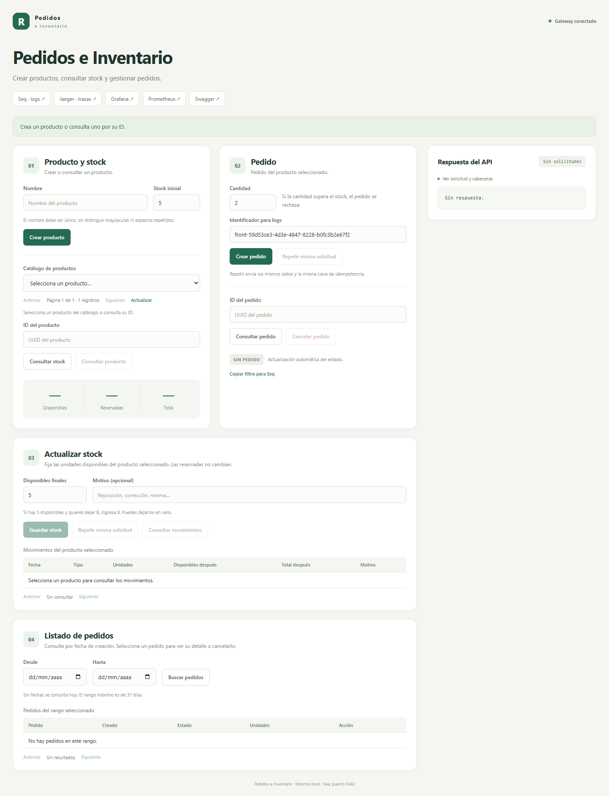

Algunas cosas útiles:

- Cada acción del front aparece en el panel "Respuesta del API" (a la derecha, o debajo en pantallas chicas), con la solicitud, las cabeceras y la respuesta.
- El campo "Identificador para logs" del pedido es el `X-Correlation-Id`. Con ese valor se filtra en Seq y se siguen los tres servicios juntos. El botón "Copiar filtro para Seq" arma la consulta lista para pegar.
- En Seq se filtra escribiendo en la barra de arriba, por ejemplo `correlationId = 'mi-id'`, `orderId = '<uuid>'` o `@Level = 'WARN'` para ver solo advertencias (los niveles se llaman `INFO`, `WARN` y `ERROR`).
- Las horas que muestra Seq están en hora local; la API de Seq las devuelve en UTC.

---

## 1. Crear un producto y confirmar un pedido

1. En la tarjeta 01, escribir un nombre nuevo (por ejemplo `Teclado prueba 808105`), dejar el stock inicial en 5 y pulsar "Crear producto".
2. Revisar el panel de respuesta: debe ser un `201` con el `productId`. El stock se ve como 5 disponibles, 0 reservadas y 5 en total.
3. En la tarjeta 02, dejar la cantidad en 2, poner un identificador reconocible (por ejemplo `prueba-01`) y pulsar "Crear pedido".
4. La respuesta es un `202` con el pedido en `PENDING`. El front consulta el estado solo y, en pocos segundos, pasa a `CONFIRMED`.
5. El stock del producto queda en 3 disponibles y 2 reservadas.

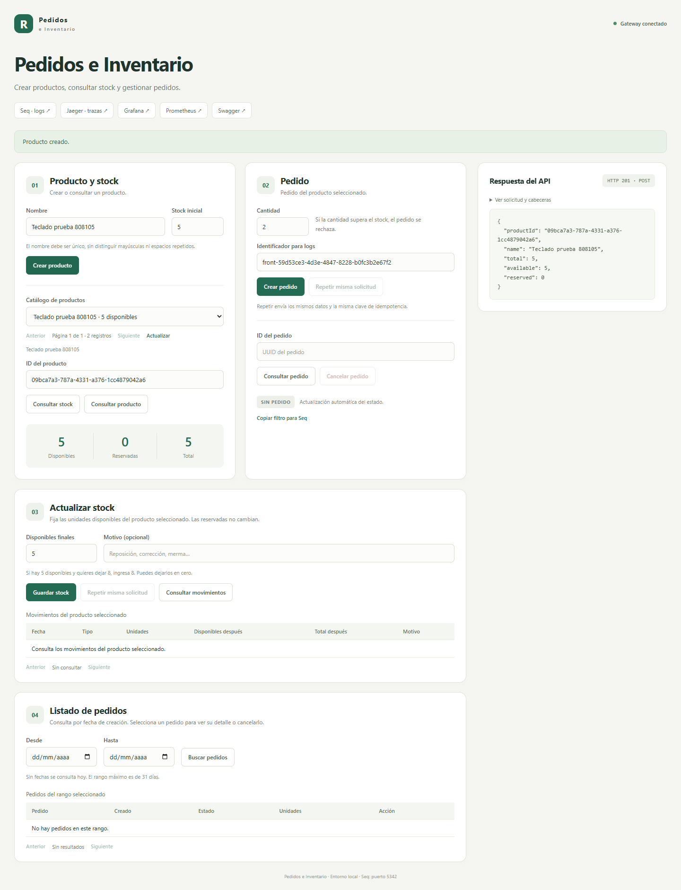

Qué mirar en Seq (`correlationId = 'prueba-01'`): la solicitud que entra al gateway y la que entra a `ms-pedidos`, el pedido colocado, el evento que recibe `ms-inventario` y la reserva aprobada, y el evento que vuelve a `ms-pedidos` con el pedido confirmado. Todos comparten el mismo `traceId`, que se puede buscar en Jaeger.

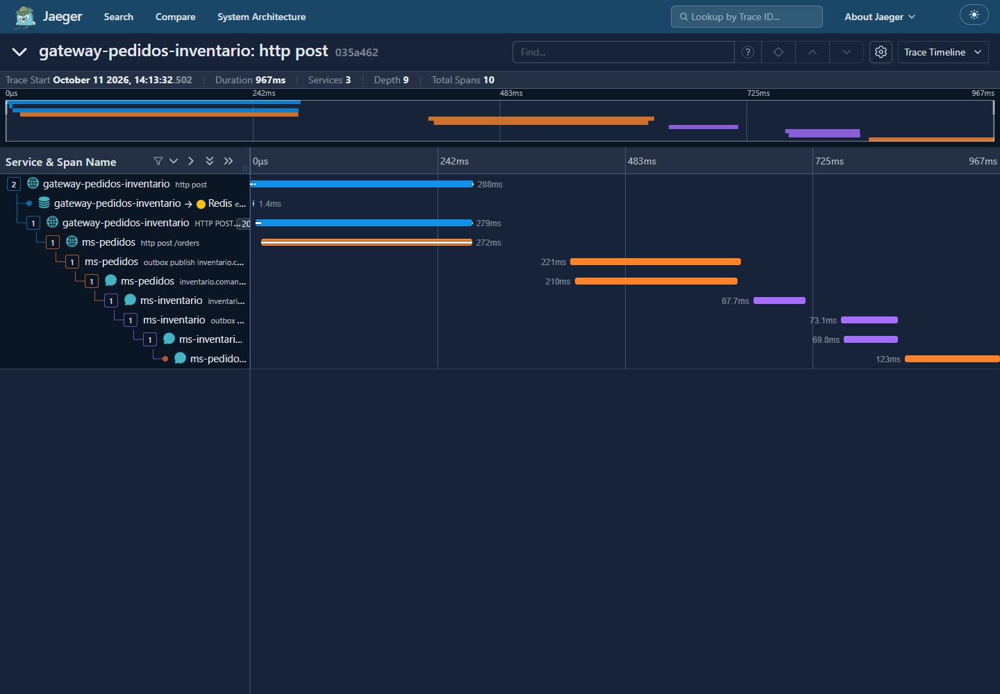

Resultado de la corrida:

| Dato | Valor |
|---|---|
| Producto | `Teclado prueba 808105`, `09bca7a3-787a-4331-a376-1cc4879042a6` |
| Respuesta al crear el producto | `201`, 5 disponibles, 0 reservadas |
| Pedido | `631829ed-b542-4444-a1df-c45e7044775e` |
| Respuesta al crear el pedido | `202`, `PENDING` |
| Estado final | `CONFIRMED` |
| Stock después | 3 disponibles, 2 reservadas, 5 en total |
| Seq | `Pedido 631829ed… confirmado en 737 ms (saga completa; …)` |
| Jaeger | traza `035a46263640c9c8ab2e69ef1f97915d`, 10 spans, 3 servicios, 967 ms |

---

## 2. Repetir la misma solicitud (idempotencia)

1. Justo después del escenario anterior, pulsar "Repetir misma solicitud" en la tarjeta 02.
2. La respuesta debe traer el mismo `orderId` y la cabecera `Idempotent-Replayed: true`.
3. El stock no cambia: sigue en 3 disponibles y 2 reservadas.

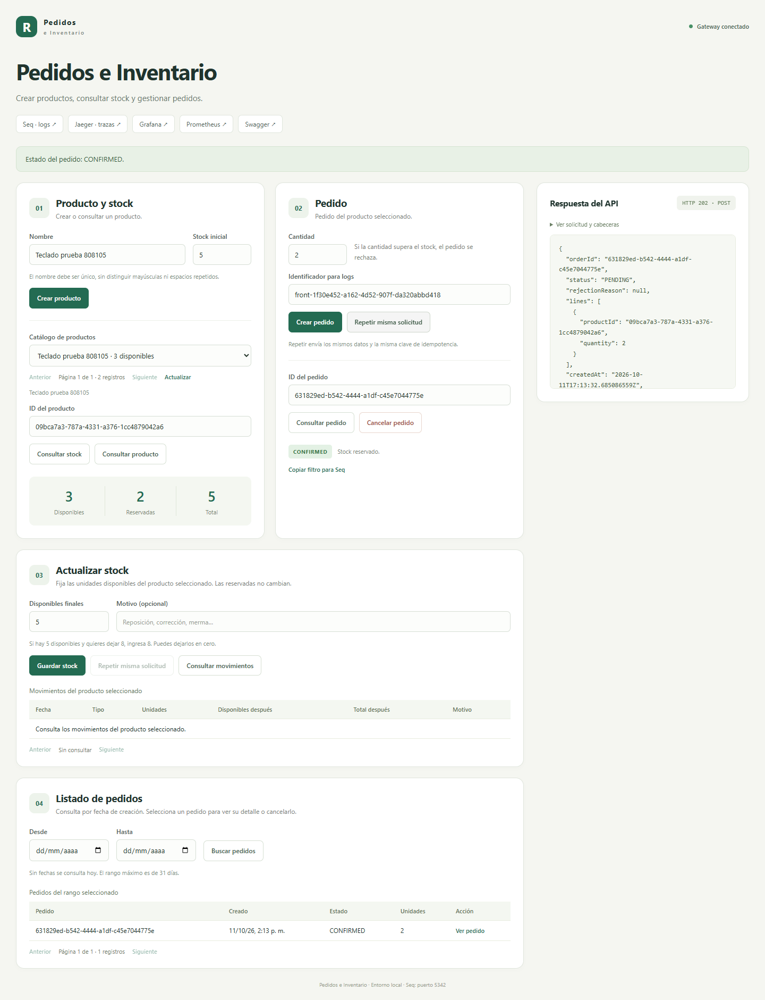

En Seq (`correlationId = 'prueba-01'`) se ve el mensaje `Solicitud repetida: se reprodujo la respuesta almacenada con la clave … (estado 202), sin volver a ejecutarla`, y no aparece un pedido nuevo.

Resultado de la corrida:

| Dato | Valor |
|---|---|
| orderId devuelto | `631829ed-b542-4444-a1df-c45e7044775e` (el mismo) |
| Cabecera | `Idempotent-Replayed: true` |
| Stock | 3 disponibles, 2 reservadas, 5 en total (sin cambios) |
| Instancia que respondió | `ms-pedidos-2`; la original había sido `ms-pedidos-1` |

---

## 3. Pedido por encima del stock

1. Con el mismo producto (quedan 3 disponibles), pedir una cantidad de 10 y crear el pedido (identificador `prueba-03`).
2. El pedido arranca en `PENDING` y termina en `REJECTED`.
3. El stock no se toca.

En Seq (`correlationId = 'prueba-03'`) aparece el motivo con las cifras.

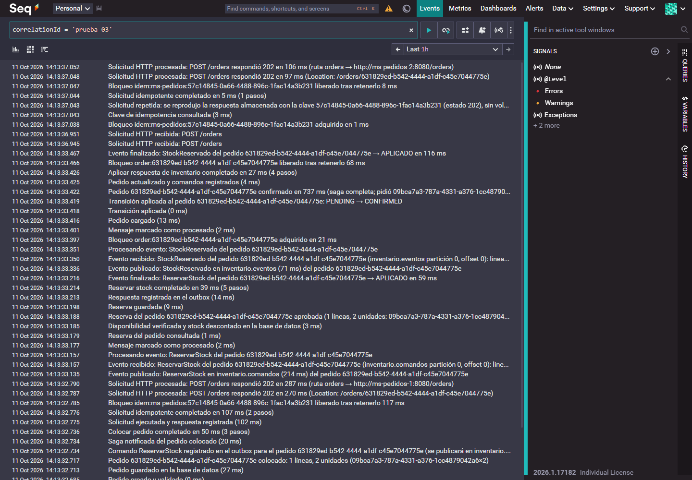

Resultado de la corrida:

| Dato | Valor |
|---|---|
| Pedido | `33c6f676-532d-489e-b0f1-eeb9db1a010c` |
| Estado final | `REJECTED`, motivo `INSUFFICIENT_STOCK` |
| Stock después | 3 disponibles, 2 reservadas, 5 en total (sin cambios) |
| Seq | `Reserva del pedido 33c6f676… rechazada por stock insuficiente: producto 09bca7a3… pedía 10 y había 3 disponibles` |
| Seq | `Pedido 33c6f676… rechazado: stock insuficiente (…) tras 340 ms` |

---

## 4. Cancelar un pedido confirmado

1. Poner el ID del pedido del escenario 1 en "ID del pedido", pulsar "Consultar pedido" y después "Cancelar pedido".
2. El estado pasa a `CANCELLED`.
3. Esperar unos segundos y consultar el stock: vuelve a 5 disponibles y 0 reservadas, porque la liberación es asíncrona.
4. Pulsar "Cancelar pedido" otra vez. La respuesta es la misma y el stock no se libera de nuevo.

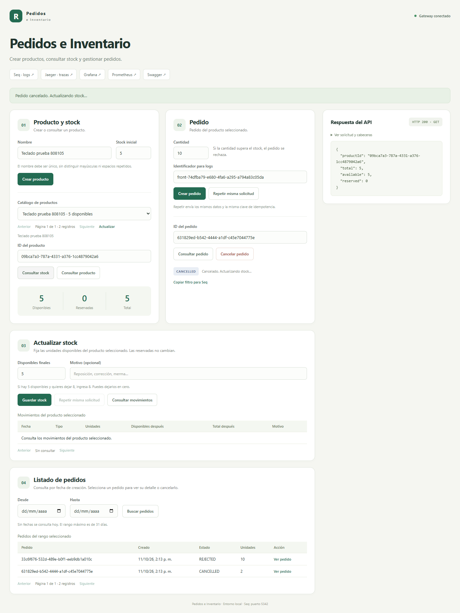

Resultado de la corrida:

| Dato | Valor |
|---|---|
| Respuesta de la cancelación | `200`, `CANCELLED` |
| Stock a los 3 segundos | 5 disponibles, 0 reservadas, 5 en total |
| Cancelación repetida | `200`, `CANCELLED`, stock igual (5 / 0 / 5) |
| Seq | `Pedido 631829ed… cancelado (pedía 09bca7a3…×2) tras 11418 ms` |

---

## 5. Cancelar un pedido rechazado

1. Poner el ID del pedido rechazado del escenario 3, pulsar "Consultar pedido" y después "Cancelar pedido".
2. La respuesta es un `409` con el código `ORDER_NOT_CANCELLABLE`.

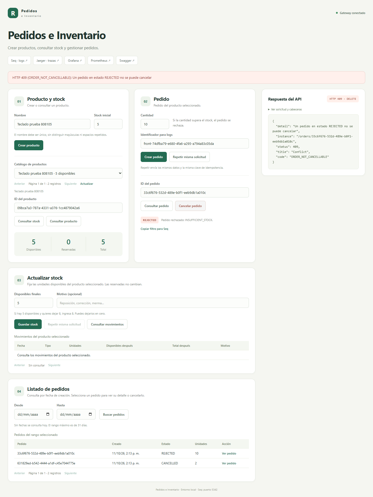

En Seq se filtra con `@Level = 'WARN'` y aparecen las advertencias de la corrida.

Resultado de la corrida:

| Dato | Valor |
|---|---|
| Respuesta del API | `409`, `ORDER_NOT_CANCELLABLE`, "Un pedido en estado REJECTED no se puede cancelar" |
| Seq (WARN) | `Respuesta de error 409 ORDER_NOT_CANCELLABLE: Un pedido en estado REJECTED no se puede cancelar` |
| Seq (WARN) | `Cancelar pedido falló tras 3 ms: Un pedido en estado REJECTED no se puede cancelar` |

---

## 6. Ajustar el stock

1. Seleccionar un producto. En la tarjeta 03, "Disponibles finales" fija cuántas unidades deben quedar (no cuántas sumar). Poner 8 y un motivo, por ejemplo `Reposición`, y pulsar "Guardar stock".
2. Pulsar "Consultar movimientos": aparece un movimiento con el motivo, la diferencia y el stock posterior.
3. Pulsar "Repetir misma solicitud": no debe crear otro movimiento.
4. Guardar otra vez el mismo valor (8) con una solicitud nueva: la respuesta indica que no hubo movimiento.
5. Crear un pedido de 2 unidades para tener reservas y fijar 0: quedan 0 disponibles y las 2 reservadas se mantienen.
6. Probar con 10.000.000 disponibles: con las reservadas, el total pasa del máximo y la respuesta es `409 STOCK_LIMIT_EXCEEDED`.

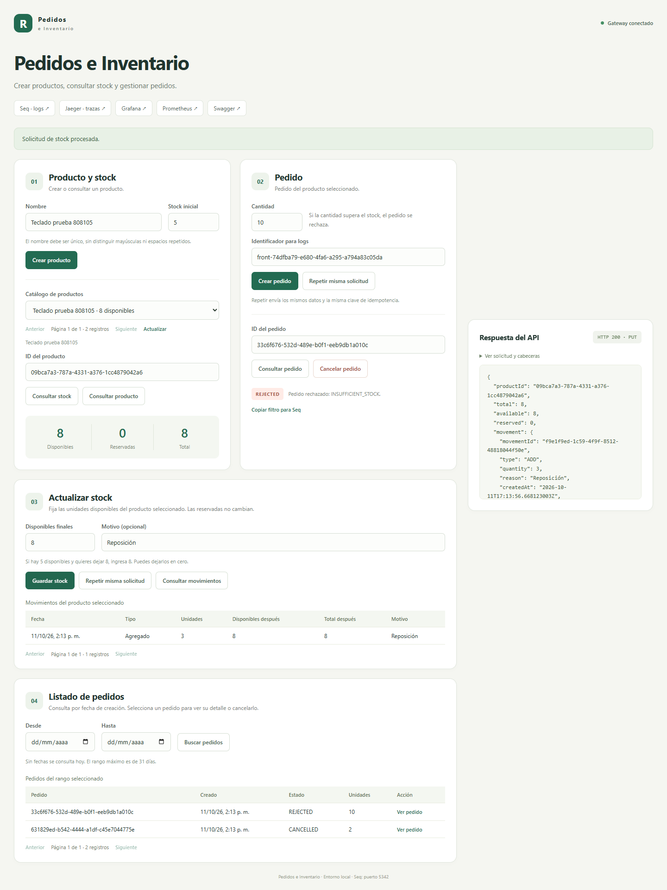

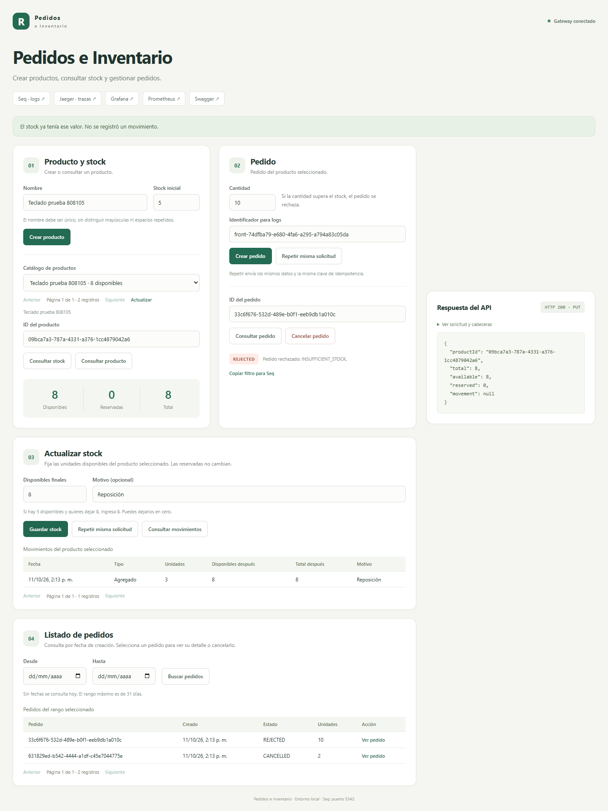

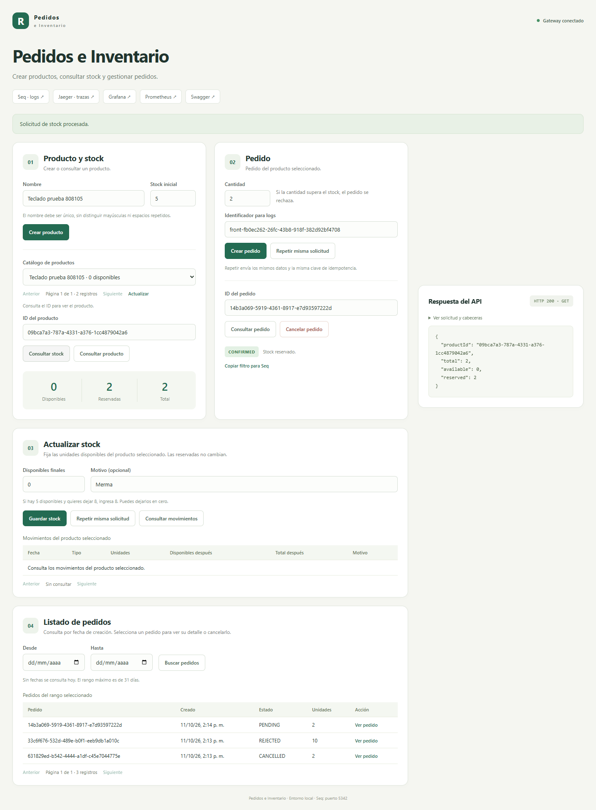

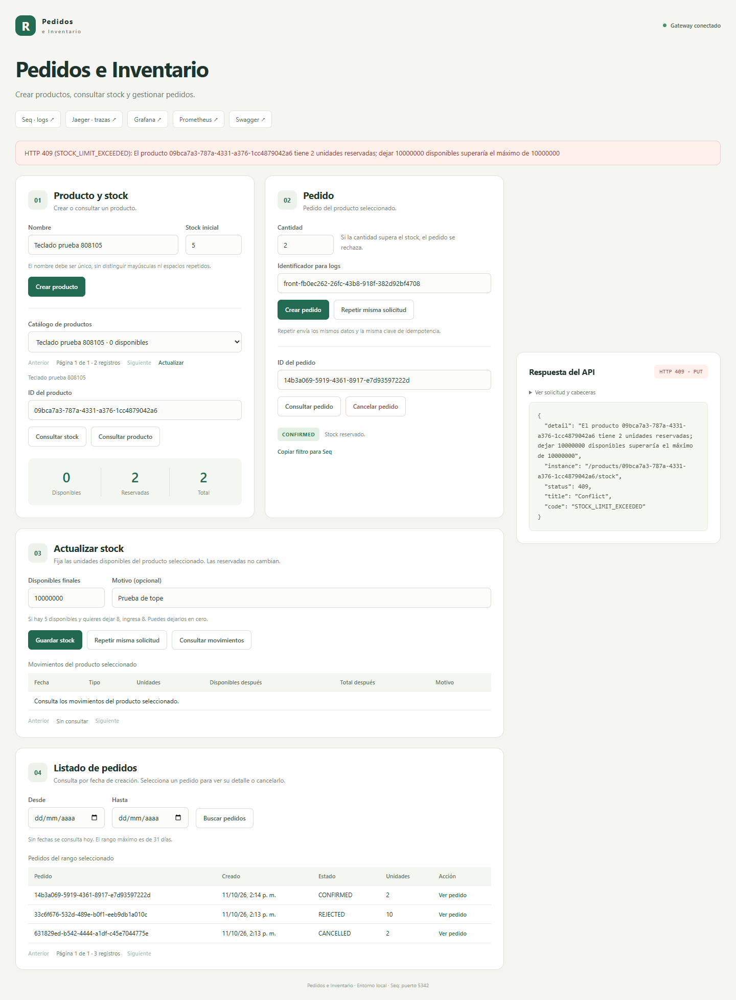

Resultado de la corrida:

| Paso | Resultado |
|---|---|
| Fijar 8 con motivo `Reposición` | `200`, total 8, disponibles 8, movimiento `ADD` de 3 unidades |
| Tabla de movimientos | 1 fila: `Agregado`, 3 unidades, 8 disponibles después, 8 en total, `Reposición` |
| Repetir la solicitud | `200`, mismo `movementId` (`f9e1f9ed-1c59-4f9f-8512-48818044f50e`), sin movimiento nuevo |
| Mismo valor (8) con otra key | `200`, `movement: null` |
| Fijar 0 con 2 reservadas | `200`, movimiento `REMOVE` de 6 unidades (`Merma`), stock 0 disponibles / 2 reservadas / 2 en total |
| Fijar 10.000.000 | `409 STOCK_LIMIT_EXCEEDED`: "tiene 2 unidades reservadas; dejar 10000000 disponibles superaría el máximo de 10000000" |

---

## 7. Nombre de producto repetido

1. Intentar crear otro producto con el mismo nombre que uno existente (da igual si cambian las mayúsculas o los espacios; en la corrida se escribió en mayúsculas).
2. La respuesta es un `409 PRODUCT_ALREADY_EXISTS` y el detalle trae el `productId` del que ya existe.

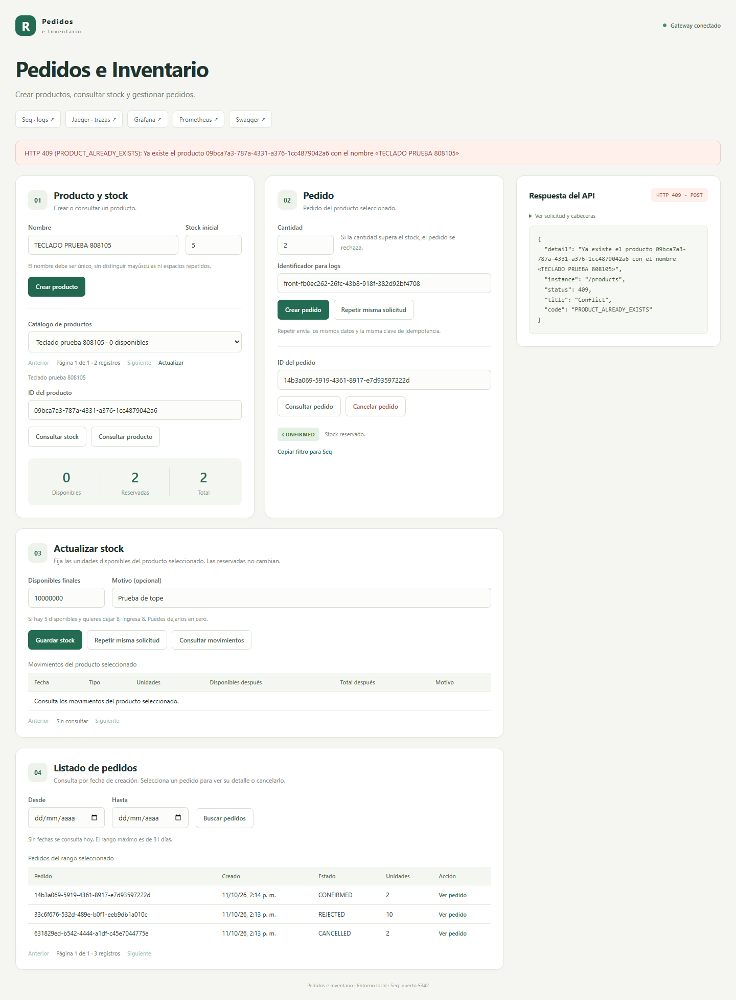

Resultado de la corrida:

| Dato | Valor |
|---|---|
| Respuesta | `409`, `PRODUCT_ALREADY_EXISTS`: "Ya existe el producto 09bca7a3-787a-4331-a376-1cc4879042a6 con el nombre «TECLADO PRUEBA 808105»" |
| Seq (WARN) | `Respuesta de error 409 PRODUCT_ALREADY_EXISTS: …` |

---

## 8. Listado de pedidos por fecha

1. En la tarjeta 04, pulsar "Buscar pedidos" sin fechas: muestra los de hoy.
2. Elegir un rango de más de 31 días: el front lo rechaza antes de enviarlo y muestra un aviso.
3. Con un rango válido, paginar con "Anterior" y "Siguiente", y usar "Ver pedido" en una fila para cargar su detalle.

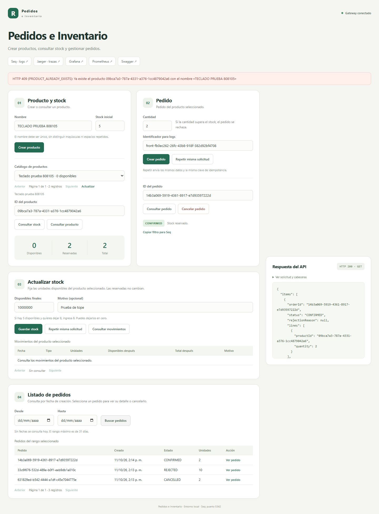

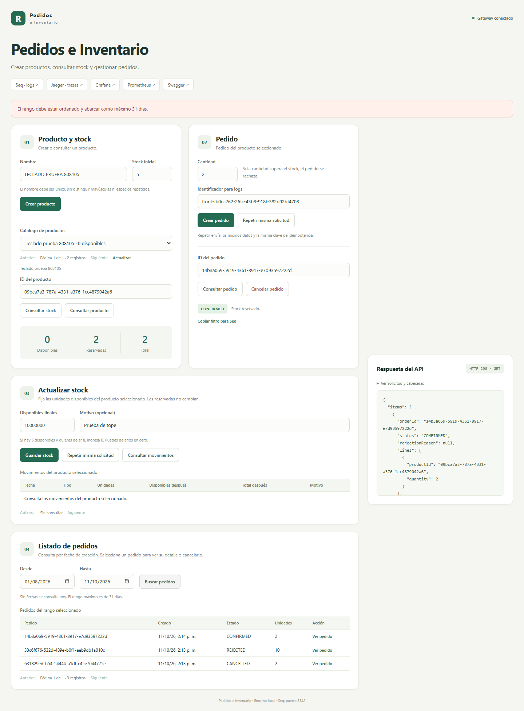

Resultado de la corrida:

| Dato | Valor |
|---|---|
| Pedidos de hoy en ese momento | 3: `CONFIRMED` (2 unidades), `REJECTED` (10) y `CANCELLED` (2) |
| Rango del 01/08/2026 al 11/10/2026 | Aviso: "El rango debe estar ordenado y abarcar como máximo 31 días." |

---

## 9. Cancelación mientras la reserva está en curso

Desde el front es difícil ganarle a la reserva, porque se resuelve en milisegundos. Se puede intentar: crear un pedido y pulsar "Cancelar pedido" lo más rápido posible. Sea cual sea el orden en que ocurran las cosas, el pedido tiene que terminar en `CANCELLED` y el stock tiene que volver al valor original.

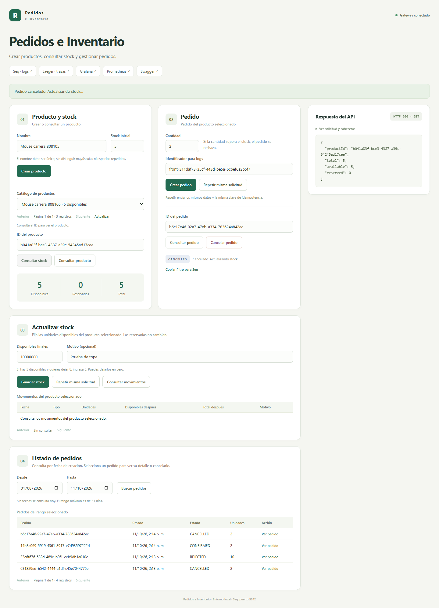

En la corrida la cancelación le ganó a la reserva por unos milisegundos. En Seq (`orderId = '<uuid>'`) la secuencia fue esta:

1. `ms-pedidos` cancela el pedido (`PENDING → CANCELLED`) y registra `LiberarStock` por cancelación del cliente.
2. `ms-inventario` recibe `ReservarStock` y aprueba la reserva, y a continuación recibe `LiberarStock` y devuelve las 2 unidades.
3. `StockReservado` llega tarde a `ms-pedidos` sobre un pedido ya cancelado: sigue `CANCELLED → CANCELLED` y se pide una liberación de compensación (`COMPENSACION_RESERVA_TARDIA`).
4. Esa liberación llega a inventario y no devuelve nada (`NADA_QUE_LIBERAR`): el stock se devolvió una sola vez.

Resultado de la corrida:

| Dato | Valor |
|---|---|
| Pedido | `b6c17e46-92a7-47eb-a334-783624a842ec` |
| Estado final | `CANCELLED` |
| Stock final | 5 disponibles, 0 reservadas, 5 en total |

Esta carrera se prueba de forma sistemática en las suites `PedidoConcurrenciaIT` e `InventarioConcurrenciaIT` (`./mvnw verify -Dgroups=concurrency`) y en `PedidoInventarioExtremoAExtremoIT`.

---

## 10. Revisión general

Al terminar los escenarios:

- En Seq, filtrar `@Level = 'ERROR'`. En una corrida normal no debería haber errores de los servicios.
- En Grafana, mirar el dashboard: pedidos por estado final, reservas por resultado, duración de la saga y mensajes en la DLT (debería estar en 0).
- En Prometheus, consultar `orders_placed_total`, `stock_reservations_total` y `messages_dlt_total` para contrastar con lo que se hizo.

Resultado de la corrida:

| Dato | Valor |
|---|---|
| Errores (`ERROR`) en Seq | 0 |
| Advertencias (`WARN`) en Seq | las de los `409` de los escenarios 5, 6 y 7 |
| Mensajes en la DLT | 0 (`messages_dlt_total` = 0) |
| Reservas | 4 aprobadas y 1 rechazada (`stock_reservations_total`) |
| Dashboard | 5 pedidos colocados, 3 confirmados, 1 rechazado y 2 cancelados; "Entregas duplicadas ignoradas" sin datos porque el front no provoca duplicados de mensajería (eso lo cubren los tests) |

El dashboard cuenta un pedido más que los de esta guía: uno creado a las 14:15, fuera del guion.

---

## Para cerrar

| Escenario | Resultado |
|---|---|
| 1. Producto y pedido confirmado | Correcto: `CONFIRMED`, stock 3 / 2 / 5 |
| 2. Repetir la solicitud | Correcto: mismo pedido, `Idempotent-Replayed: true`, sin reservar de más |
| 3. Pedido sobre el stock | Correcto: `REJECTED` por `INSUFFICIENT_STOCK`, stock intacto |
| 4. Cancelar pedido confirmado | Correcto: `CANCELLED`, stock de vuelta a 5 / 0 / 5, cancelación repetida sin efecto |
| 5. Cancelar pedido rechazado | Correcto: `409 ORDER_NOT_CANCELLABLE`, `WARN` en Seq |
| 6. Ajustar el stock | Correcto: movimientos, repetición sin duplicar, cero con reservas y `409` por el tope |
| 7. Nombre repetido | Correcto: `409 PRODUCT_ALREADY_EXISTS` |
| 8. Listado por fecha | Correcto: pedidos de hoy y aviso por rango largo |
| 9. Cancelación en carrera | Correcto: `CANCELLED`, stock devuelto una sola vez |
| 10. Revisión general | Correcto: 0 errores, 0 mensajes en la DLT |

Para anotar observaciones propias:

-
